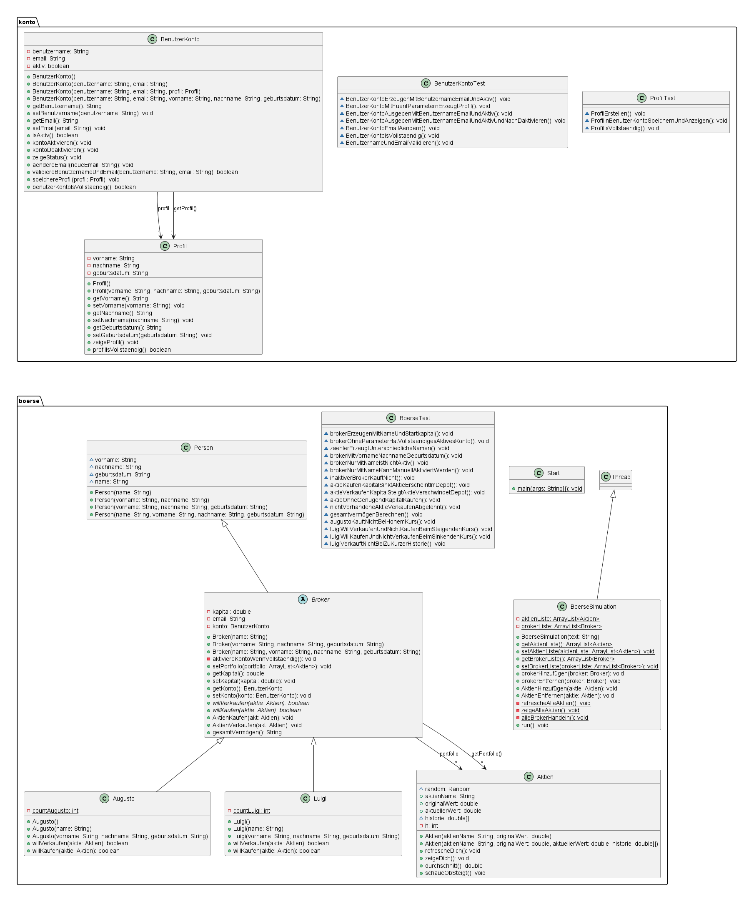

# Boerse2026 – Börsensimulation in Java

> Eine Konsolen-Börsensimulation mit Aktien, deren Kurse sich laufend ändern, und Brokern mit eigener Handelsstrategie und eigenem Benutzerkonto. Entstanden in der Berufsschule während der Umschulung zur Fachinformatikerin Anwendungsentwicklung.

## Projektbeschreibung

Die Simulation läuft in einem eigenen **Thread**. In jeder Runde bekommen alle Aktien einen neuen Zufallskurs. Danach entscheidet jeder Broker nach seiner Strategie, ob er kauft oder verkauft. Handeln darf ein Broker aber nur mit einem **aktiven Benutzerkonto**, und aktiv wird das Konto erst mit einem vollständigen Profil. Alle 10 Runden zeigt die Börse das Gesamtvermögen jedes Brokers an.
Das Projekt übt **objektorientiertes Design** mit abstrakten Klassen, Vererbung, Polymorphie und Komposition, dazu **Multithreading** und **Unit-Tests mit JUnit 5**.



Das Klassendiagramm gibt es auch als PDF: [Klassendiagramm.pdf](Klassendiagramm.pdf)

## Funktionsumfang

### Eingaben
- Keine Benutzereingabe: Aktien und Broker werden in `Start.java` angelegt
- Aktien lassen sich auch während der laufenden Simulation hinzufügen (Beispiel: Mercedes)

### Kursberechnung (`Aktien.refrescheDich()`)
| Schritt | Logik |
|---|---|
| Neuer Kurs | `originalWert × (Zufall 0.0–1.0 + 0.5)` → 50 % bis 150 % des Startwerts |
| Historie | Die letzten 10 Kurse liegen in einem Ringpuffer (`h % 10`) |
| Trend | Liegt der Durchschnitt der Historie über dem Startwert → „KAUFEN“, sonst Warnung |

### Broker-Strategien
| Broker | Kauft, wenn … | Verkauft, wenn … |
|---|---|---|
| **Augusto** (feste Schwelle) | Kurs ≤ 90 % des Startwerts | Kurs ≥ 110 % des Startwerts |
| **Luigi** (Trendfolger) | Kurs ≤ 95 % des Durchschnitts der Historie | Kurs ≥ 105 % des Durchschnitts der Historie (nur mit 10 Werten in der Historie) |

### Broker erzeugen & Benutzerkonto (`konto`)
| Konstruktor | Name | Konto |
|---|---|---|
| `new Luigi()` / `new Augusto()` | automatisch mit Zähler: `Luigi_1`, `Augusto_2` … | Standardprofil → **sofort aktiv** |
| `new Augusto("Max", "Mustermann", "01.01.2000")` | `Max_Mustermann` | vollständiges Profil → **sofort aktiv** |
| `new Luigi("Max")` | `Max` | leeres Profil → **inaktiv**, manuell mit `kontoAktivieren()` |

| Kontoregel | Ergebnis |
|---|---|
| Kein Profil vorhanden | `kontoAktivieren()` wird abgelehnt |
| Benutzername, E-Mail und vollständiges Profil vorhanden | `benutzerKontoIsVollstaendig()` → `true` |
| E-Mail des Brokers | `<name>@broker.de` |
| Konto inaktiv | `willKaufen()` / `willVerkaufen()` geben `false` zurück |

### Handelsregeln (`Broker`)
| Bedingung | Ergebnis |
|---|---|
| Konto aktiv, Strategie sagt „kaufen“ **und** genug Kapital | Aktie kommt ins Depot, Kapital sinkt |
| Zu wenig Kapital | Kauf wird abgelehnt |
| Konto aktiv, Strategie sagt „verkaufen“ **und** Aktie im Depot | Aktie verlässt das Depot, Kapital steigt |
| Aktie nicht im Depot | Verkauf wird abgelehnt |
| Startkapital | 10 000 € pro Broker |

### Ausgabe
- Rundennummer, aktueller Kurs und Trend jeder Aktie
- Kauf- und Verkaufsmeldungen der Broker mit Restkapital
- Alle 10 Runden: Gesamtvermögen jedes Brokers (Kapital + Depotwert)

## Verwendete Java-Konzepte

| Konzept | Anwendung im Projekt |
|---|---|
| Abstrakte Klassen | `Person` → `Broker` mit abstrakten Methoden `willKaufen()` / `willVerkaufen()` |
| Vererbung & Polymorphie | `Augusto` und `Luigi` überschreiben die Strategie mit `@Override` |
| Komposition | `Broker` **hat ein** `BenutzerKonto`, das Konto **hat ein** `Profil` |
| Pakete & `import` | Zwei Pakete: `boerse` und `konto` (`import konto.*;`) |
| Kapselung | `private` Felder mit Gettern und Settern |
| Konstruktor-Überladung & `this(...)` | `Person`, `Broker`, `BenutzerKonto`: mehrere Konstruktoren, die sich gegenseitig aufrufen |
| `static` Zähler | `countLuigi` / `countAugusto` erzeugen eindeutige Namen |
| `Thread` / `run()` | `BoerseSimulation extends Thread` lässt die Börse parallel zu `main` laufen |
| `Thread.sleep()` + `try/catch` | Pause zwischen den Runden, `InterruptedException` wird abgefangen |
| `ArrayList` | Aktienliste, Brokerliste und Depot |
| Arrays & Ringpuffer | `double[10]` Kurshistorie mit Modulo-Index |
| Ternärer Operator | `aktiv ? "Ja" : "Nein"` in `zeigeStatus()` |
| `java.util.Random` | Zufällige Kursschwankung |
| `String.format("%.2f")` | Beträge mit zwei Nachkommastellen |
| JUnit 5 | 26 Tests: `BoerseTest` (16), `BenutzerKontoTest` (7), `ProfilTest` (3) |

## Projektstruktur

```
Klassendiagramm.png            # UML-Klassendiagramm (konto und boerse)
Klassendiagramm.pdf
src/
├── boerse/
│   ├── Start.java             # Einstiegspunkt (main)
│   ├── BoerseSimulation.java  # Börse als Thread
│   ├── Aktien.java            # Aktie mit Kurs und Historie
│   ├── Person.java            # abstrakte Basisklasse
│   ├── Broker.java            # abstrakter Broker mit Konto und Kauf- und Verkaufslogik
│   ├── Augusto.java           # Strategie: feste Schwellen
│   ├── Luigi.java             # Strategie: Durchschnitt der Historie
│   └── BoerseTest.java        # JUnit-5-Tests
├── konto/
│   ├── BenutzerKonto.java     # Benutzername, E-Mail, aktiv, Profil
│   ├── Profil.java            # Vorname, Nachname, Geburtsdatum
│   ├── BenutzerKontoTest.java
│   └── ProfilTest.java
└── module-info.java
```

## Ausführen

**In Eclipse:** Projekt importieren (*File → Import → Existing Projects into Workspace*), dann `boerse/Start.java` → *Run As → Java Application*.
Tests: Rechtsklick auf `src` → *Run As → JUnit Test*.

**Über die Konsole** (ohne Tests):

```bash
javac -d bin src/boerse/Aktien.java src/boerse/Augusto.java src/boerse/BoerseSimulation.java src/boerse/Broker.java src/boerse/Luigi.java src/boerse/Person.java src/boerse/Start.java src/konto/BenutzerKonto.java src/konto/Profil.java
```

```bash
java -cp bin boerse.Start
```

> **Voraussetzungen:** Java 17 oder neuer. Für die Tests: JUnit 5 (in Eclipse schon enthalten).
> Die Simulation läuft endlos weiter. Beenden mit `Strg + C` oder über den roten Stopp-Button in Eclipse.

## Über die Entwicklerin

Dieses Projekt ist eine Übungsaufgabe aus der Berufsschule.
Es zeigt, dass ich ein Problem mit **abstrakten Klassen und Polymorphie** sauber modellieren kann: Jeder Broker bringt seine eigene Strategie mit, ohne dass die Börse den Unterschied kennen muss. Mit dem Paket `konto` habe ich das Projekt um **Komposition** erweitert. Dazu kommt ein **Thread**, und die gesamte Logik ist mit **26 JUnit-Tests** abgesichert.
