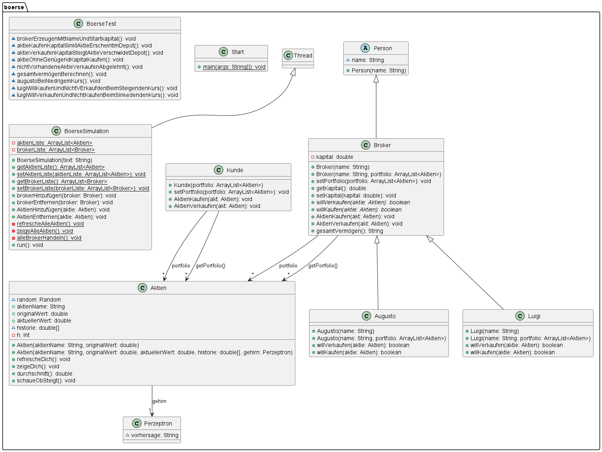

# ☕ Boerse2026 – Börsensimulation in Java

> Eine Konsolen-Börsensimulation mit Aktien, deren Kurse sich laufend ändern, und Brokern mit eigener Handelsstrategie. Entstanden in der Berufsschule während der Umschulung zur Fachinformatikerin Anwendungsentwicklung.

## 📋 Projektbeschreibung

Die Simulation läuft in einem eigenen **Thread**. In jeder Runde bekommen alle Aktien einen neuen Zufallskurs. Danach werden die Kurse samt Verlauf ausgegeben, und jeder Broker entscheidet nach seiner Strategie, ob er kauft oder verkauft. Alle 10 Runden zeigt die Börse das Gesamtvermögen jedes Brokers an.
Das Projekt übt **objektorientiertes Design** mit abstrakten Klassen, Vererbung und Polymorphie, dazu **Multithreading** und **Unit-Tests mit JUnit 5**.



## 🔧 Funktionsumfang

### Eingaben
- Keine Benutzereingabe: Aktien und Broker werden in `Start.java` angelegt
- Aktien lassen sich auch während der laufenden Simulation hinzufügen (Beispiel: Mercedes)

### Kursberechnung (`Aktien.refrescheDich()`)
| Schritt | Logik |
|---|---|
| Neuer Kurs | `originalWert × (Zufall 0.0–1.0 + 0.5)` → 50 % bis 150 % des Startwerts |
| Historie | Die letzten 10 Kurse liegen in einem Ringpuffer (`h % 10`) |
| Trend | Liegt der Durchschnitt der Historie über dem Startwert → „KAUFEN“, sonst Warnung |

### Broker-Strategien
| Broker | Kauft, wenn … | Verkauft, wenn … |
|---|---|---|
| **Augusto** (feste Schwelle) | Kurs ≤ 90 % des Startwerts | Kurs ≥ 110 % des Startwerts |
| **Luigi** (Trendfolger) | Kurs ≤ 95 % des Durchschnitts der Historie | Kurs ≥ 105 % des Durchschnitts der Historie |

### Handelsregeln (`Broker`)
| Bedingung | Ergebnis |
|---|---|
| Strategie sagt „kaufen“ **und** genug Kapital | Aktie kommt ins Depot, Kapital sinkt |
| Zu wenig Kapital | Kauf wird abgelehnt |
| Strategie sagt „verkaufen“ **und** Aktie im Depot | Aktie verlässt das Depot, Kapital steigt |
| Aktie nicht im Depot | Verkauf wird abgelehnt |
| Startkapital | 10 000 € pro Broker |

### Ausgabe
- Rundennummer, aktueller Kurs und Historie jeder Aktie
- Kauf- und Verkaufsmeldungen der Broker mit Restkapital
- Alle 10 Runden: Gesamtvermögen jedes Brokers (Kapital + Depotwert)

## 💡 Verwendete Java-Konzepte

| Konzept | Anwendung im Projekt |
|---|---|
| Abstrakte Klassen | `Person` → `Broker` mit abstrakten Methoden `willKaufen()` / `willVerkaufen()` |
| Vererbung & Polymorphie | `Augusto` und `Luigi` überschreiben die Strategie mit `@Override` |
| Kapselung | `private` Felder `portfolio` und `kapital` mit Gettern und Settern |
| Konstruktor-Überladung | `Aktien`, `Broker`: je ein einfacher und ein vollständiger Konstruktor |
| `Thread` / `run()` | `BoerseSimulation extends Thread` lässt die Börse parallel zu `main` laufen |
| `Thread.sleep()` + `try/catch` | Pause zwischen den Runden, `InterruptedException` wird abgefangen |
| `ArrayList` | Aktienliste, Brokerliste und Depot |
| Arrays & Ringpuffer | `double[10]` Kurshistorie mit Modulo-Index |
| `static` | Gemeinsame Aktien- und Brokerlisten der Börse |
| `java.util.Random` | Zufällige Kursschwankung |
| `String.format("%.2f")` | Beträge mit zwei Nachkommastellen |
| JUnit 5 | `BoerseTest`: 9 Tests für Kauf, Verkauf, Kapital, Gesamtvermögen und Strategien |
| `java.lang.IO` | Kompakte Konsolenausgabe (`IO.println`) aus neueren Java-Versionen |

## 📁 Projektstruktur

```
src/
├── boerse/
│   ├── Start.java             # Einstiegspunkt (main)
│   ├── BoerseSimulation.java  # Börse als Thread
│   ├── Aktien.java            # Aktie mit Kurs und Historie
│   ├── Person.java            # abstrakte Basisklasse
│   ├── Broker.java            # abstrakter Broker mit Kauf- und Verkaufslogik
│   ├── Augusto.java           # Strategie: feste Schwellen
│   ├── Luigi.java             # Strategie: Durchschnitt der Historie
│   ├── Kunde.java             # einfacher Kunde mit Depot
│   ├── Perzeptron.java        # Platzhalter für eine spätere KI-Vorhersage
│   └── BoerseTest.java        # JUnit-5-Tests
├── BoerseKI/                  # Vorlage aus dem Unterricht (Ausgangsversion)
│   ├── StartKI.java
│   ├── BoerseKI.java
│   └── AktieKI.java
├── BoerseKlassendiagramm.png
└── module-info.java
```

## ▶️ Ausführen

**In Eclipse:** Projekt importieren (*File → Import → Existing Projects into Workspace*), dann `boerse/Start.java` → *Run As → Java Application*.
Tests: `BoerseTest.java` → *Run As → JUnit Test*.

**Über die Konsole** (ohne Tests):

```bash
javac -d bin src/boerse/Aktien.java src/boerse/Augusto.java src/boerse/BoerseSimulation.java src/boerse/Broker.java src/boerse/Kunde.java src/boerse/Luigi.java src/boerse/Person.java src/boerse/Perzeptron.java src/boerse/Start.java
```

```bash
java -cp bin boerse.Start
```

> **Voraussetzungen:** Java 25 oder neuer (wegen `java.lang.IO`). Für die Tests: JUnit 5 (in Eclipse schon enthalten).
> Die Simulation läuft endlos weiter. Beenden mit `Strg + C` oder über den roten Stopp-Button in Eclipse.

## 👩‍💻 Über die Entwicklerin

Dieses Projekt ist eine Übungsaufgabe aus der Berufsschule.
Es zeigt, dass ich ein Problem mit **abstrakten Klassen und Polymorphie** sauber modellieren kann: Jeder Broker bringt seine eigene Strategie mit, ohne dass die Börse den Unterschied kennen muss. Außerdem zeigt es, dass ich einen **Thread** einsetzen und meine Logik mit **JUnit-Tests** absichern kann.
